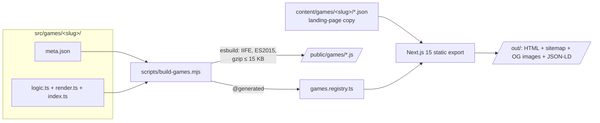

# E-Ink Games

Free browser games designed for e-ink screens — pure black & white, zero animation, zero flicker. Play right in the browser of your Kindle, BOOX or Kobo: no download, no install, no jailbreak.

**Live site: <https://games.e-ink.me>** · [简体中文](README.zh-CN.md)

Part of the [E-Ink.me](https://e-ink.me) family of e-reader tools.

## Games

| Game | Category | Highlights |
| --- | --- | --- |
| [Sudoku](https://games.e-ink.me/en/games/sudoku/) | Puzzle | 4 difficulties, pencil marks, seeded puzzles, undo, timer |
| [2048](https://games.e-ink.me/en/games/2048/) | Puzzle | Keyboard & touch, undo, best-score tracking |
| [Minesweeper](https://games.e-ink.me/en/games/minesweeper/) | Puzzle | Flags, chording, timer |
| [Nonogram](https://games.e-ink.me/en/games/nonogram/) | Logic | Seeded picross puzzles, undo, timer |
| [Memory Pairs](https://games.e-ink.me/en/games/memory/) | Puzzle | Three board sizes, timer |
| [Tic-Tac-Toe](https://games.e-ink.me/en/games/tic-tac-toe/) | Board | Unbeatable minimax AI on hard mode |
| [Hangman](https://games.e-ink.me/en/games/hangman/) | Word | On-screen keypad, three word difficulties |
| [Hidden Code](https://games.e-ink.me/en/games/hidden-code/) | Logic | Mastermind-style code breaking, undo |
| [Word Daily](https://games.e-ink.me/en/games/word-daily/) | Daily | One Wordle-style puzzle per day, same for everyone |
| [Word Search](https://games.e-ink.me/en/games/word-search/) | Word | Three grid sizes, timer |

## Built e-ink first

E-ink browsers are slow, memory-constrained, and refresh the whole screen on every paint. Everything here is tuned for that reality:

- **Zero runtime requests from game code** — games run entirely in the page and keep working offline once loaded.
- **No animation, no hover, no gradients** — 1-bit friendly UI where state is encoded in weight and texture, not color.
- **Minimal dirty-region DOM patching** — only changed cells are touched, so e-ink panels can do partial refreshes instead of full-screen flashes.
- **Tiny bundles** — each game compiles to a standalone ES2015 IIFE, gzip ≤ 15 KB (enforced at build time).
- **Progressive enhancement** — every page's content (rules, FAQ, device compatibility, navigation) is fully readable with JavaScript disabled; the interactive game is layered on top.
- **Storage with graceful degradation** — saves fall back from `localStorage` to cookies to in-memory, so progress survives on quirky e-ink browsers.

## Architecture

Game code is deliberately decoupled from the site framework. Next.js only renders the static shell (landing pages, SEO, i18n); each game is a vanilla-JS bundle that mounts itself into the page outside the React hydration path.



**Per-game contract** — every game is exactly four files:

- `logic.ts` — pure game logic. No DOM, no React, no third-party deps; fully unit-testable.
- `render.ts` — DOM rendering with minimal patching. May only import `./logic` and `_engine/*`.
- `index.ts` — bundle entry: feature detection, mount, global registration.
- `meta.json` — machine-readable metadata (category, difficulties, features, SEO hints).

**Everything is registry-driven.** The build script globs `src/games/*/meta.json`, validates it, compiles each game, and regenerates `src/lib/games.registry.ts`. Game pages, category listings, sitemap, hreflang alternates, OG images and JSON-LD all appear automatically from the registry — no hand-maintained lists anywhere.

**Shared engine** (`src/games/_engine/`): seeded RNG (reproducible & daily puzzles), turn-based state machine with undo, three-tier storage, tiny event emitter, i18n word injection.

Guardrails are enforced at build time rather than hoped for: a bundle that imports React fails the build, an over-budget gzip size fails the build, an invalid `meta.json` fails the build.

## Project structure

```
src/
├── app/[locale]/           # Pages: home, about, games/[slug] (per-locale static export)
├── components/             # Shell components: GameFrame, GameShell, LanguageMenu, SEO
├── content/games/<slug>/   # Landing-page copy (en.json is source of truth, others fall back)
├── games/
│   ├── _engine/            # Shared runtime: storage, seeded RNG, events, undo state machine
│   ├── _template/          # Copy-me template for new games
│   └── <slug>/             # One directory per game: logic / render / index / meta.json
├── lib/                    # i18n (16 locales), SEO helpers, generated games registry
scripts/                    # build-games, gen-og, gen-sitemap
public/games/               # Compiled game bundles (build output, committed)
docs/                       # Design docs (in Chinese)
```

## Getting started

Requires Node.js ≥ 20 (`python3` on PATH for the static preview server).

```bash
npm install
npm run dev        # builds game bundles, then starts Next.js dev server
```

Other commands:

| Command | Purpose |
| --- | --- |
| `npm test` | Vitest unit tests (game logic, i18n dictionaries, content contracts) |
| `npm run typecheck` | `tsc --noEmit` over the whole repo |
| `npm run build` | Full production build: games → registry → OG images → static export → sitemap |
| `npm run preview` | Serve the exported `out/` directory locally |

## Adding a game

Adding a game touches no routes and no registries — copy the template and fill in four files:

1. `cp -r src/games/_template src/games/<slug>` (directory name = slug, `[a-z0-9-]+`)
2. Fill in `meta.json`, then implement `logic.ts`, `render.ts`, `index.ts`
3. Add landing-page copy in `src/content/games/<slug>/en.json` (other languages optional, they fall back to `en`)
4. Run `npm run build:games` — the bundle, registry entry, page, sitemap entry, hreflang set and OG image are generated automatically

See [`src/content/README.md`](src/content/README.md) for the content schema and `docs/开发规约-游戏扩展框架.md` for the full framework contract (in Chinese).

## Internationalization

16 locales out of the box — English, 简体中文, Deutsch, Español, Français, Italiano, Português, 日本語, 한국어, Русский, Nederlands, Polski, Türkçe, Svenska, العربية (RTL), 繁體中文. Site chrome, per-game UI vocabulary and landing-page content each have their own dictionaries with field-level fallback to English; hreflang/canonical/sitemap follow the locale list automatically.

## Deployment

`npm run build` produces a fully static site in `out/` — host it anywhere. Production runs on Cloudflare Pages. There is no server, no database, no runtime dependency; analytics (optional GA4, self-hosted cookieless Umami by default) is the only external script the pages reference.

## Contributing

Bug reports and new-game PRs are welcome. A PR adding a game should follow the four-file contract above and include unit tests for `logic.ts`. Note that the design docs under `docs/` are written in Chinese; code comments follow suit — don't let that stop you, English is fine in issues and PRs.

## License

[MIT](LICENSE)
