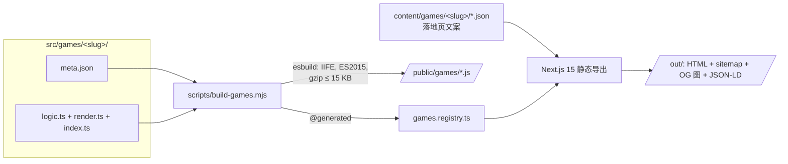

# E-Ink Games 墨水屏游戏

为电子墨水屏打造的免费网页游戏 —— 纯黑白、零动画、零闪烁。在 Kindle、BOOX、Kobo 的浏览器里直接玩：无需下载、无需安装、无需越狱。

**线上站点：<https://games.e-ink.me>** · [English](README.md)

[E-Ink.me](https://e-ink.me) 家族成员之一。

## 游戏列表

| 游戏 | 分类 | 亮点 |
| --- | --- | --- |
| [数独 Sudoku](https://games.e-ink.me/zh/games/sudoku/) | 益智 | 4 档难度、铅笔备注、可复现种子局、撤销、计时 |
| [2048](https://games.e-ink.me/zh/games/2048/) | 益智 | 键盘 + 触屏、撤销、最佳成绩 |
| [扫雷 Minesweeper](https://games.e-ink.me/zh/games/minesweeper/) | 益智 | 插旗、双击展开、计时 |
| [数织 Nonogram](https://games.e-ink.me/zh/games/nonogram/) | 逻辑 | 种子题库、撤销、计时 |
| [记忆翻牌 Memory Pairs](https://games.e-ink.me/zh/games/memory/) | 益智 | 三档棋盘、计时 |
| [井字棋 Tic-Tac-Toe](https://games.e-ink.me/zh/games/tic-tac-toe/) | 棋盘 | 困难模式为不可战胜的 minimax AI |
| [刽子手 Hangman](https://games.e-ink.me/zh/games/hangman/) | 文字 | 屏上键盘、三档词库难度 |
| [隐秘代码 Hidden Code](https://games.e-ink.me/zh/games/hidden-code/) | 逻辑 | Mastermind 式破译、撤销 |
| [每日一词 Word Daily](https://games.e-ink.me/zh/games/word-daily/) | 每日 | Wordle 式每日一题，全球同题 |
| [单词搜索 Word Search](https://games.e-ink.me/zh/games/word-search/) | 文字 | 三档网格、计时 |

## 墨水屏优先的设计

墨水屏浏览器慢、内存小，且每次重绘都伴随全屏刷新。本站所有细节都为此而生：

- **游戏代码零运行时请求** —— 加载完成后完全在页面内运行，离线可玩。
- **无动画、无 hover、无渐变** —— 1-bit 友好的 UI，状态靠线宽与纹理编码而非颜色。
- **最小脏区 DOM patch** —— 只改动变化的格子，让墨水屏做局部刷新而非全屏闪黑。
- **极小体积** —— 每款游戏编译为独立 ES2015 IIFE，gzip ≤ 15 KB（构建期强制断言）。
- **渐进增强** —— 玩法说明、FAQ、设备兼容表、站内导航等内容层禁用 JS 也完整可读，交互游戏在其上按需注入。
- **存档三级降级** —— `localStorage` → cookie → 内存，在古怪的墨水屏浏览器上进度也能尽力保留。

## 架构

游戏代码与站点框架刻意解耦：Next.js 只负责静态壳层（落地页、SEO、多语言），每款游戏是独立的 vanilla JS bundle，在 React 水合链路之外自行挂载。



**每游戏四件套契约**：

- `logic.ts` —— 纯函数游戏逻辑。零 DOM、零 React、零第三方依赖，可完整单测。
- `render.ts` —— 最小 patch 的 DOM 渲染层。只允许 import `./logic` 与 `_engine/*`。
- `index.ts` —— bundle 唯一入口：特性检测、挂载、全局注册。
- `meta.json` —— 机器可读元数据（分类、难度、特性、SEO 提示）。

**一切由 registry 驱动**：构建脚本 glob `src/games/*/meta.json`，校验、逐游戏打包，再生成 `src/lib/games.registry.ts`。游戏页、分类页、sitemap、hreflang、OG 分享图、JSON-LD 全部随 registry 自动出现 —— 全站没有任何手工维护的游戏清单。

**公共引擎**（`src/games/_engine/`）：可种子化随机（复现局与每日题）、带撤销的回合制状态机、三级存储、极简事件发射器、引擎词表 i18n 注入。

硬约束在构建期强制执行：bundle 里解析到 React 依赖即构建失败、gzip 超预算即构建失败、`meta.json` 非法即构建失败。

## 目录结构

```
src/
├── app/[locale]/           # 页面：首页、关于、games/[slug]（按语言静态导出）
├── components/             # 壳层组件：GameFrame、GameShell、LanguageMenu、SEO
├── content/games/<slug>/   # 落地页文案（en.json 为 source of truth，其余语言缺字段回退 en）
├── games/
│   ├── _engine/            # 公共运行时：存储、种子 RNG、事件、撤销状态机
│   ├── _template/          # 新游戏模板（复制即用）
│   └── <slug>/             # 每游戏一目录：logic / render / index / meta.json
├── lib/                    # i18n（16 语言）、SEO 工具、生成的 games registry
scripts/                    # build-games、gen-og、gen-sitemap
public/games/               # 编译产物 bundle（构建生成，入库提交）
docs/                       # 设计文档
```

## 快速开始

要求 Node.js ≥ 20（静态预览服务器需要 PATH 里有 `python3`）。

```bash
npm install
npm run dev        # 先构建游戏 bundle，再启动 Next.js 开发服务器
```

其余命令：

| 命令 | 用途 |
| --- | --- |
| `npm test` | Vitest 单元测试（游戏逻辑、i18n 字典、内容契约） |
| `npm run typecheck` | 全仓 `tsc --noEmit` 类型检查 |
| `npm run build` | 完整生产构建：游戏 → registry → OG 图 → 静态导出 → sitemap |
| `npm run preview` | 本地起服务预览导出产物 `out/` |

## 新增一款游戏

新增游戏不改路由、不登记注册表 —— 复制模板、填四个文件即可：

1. `cp -r src/games/_template src/games/<slug>`（目录名 = slug，`[a-z0-9-]+`）
2. 填 `meta.json`，实现 `logic.ts`、`render.ts`、`index.ts`
3. 在 `src/content/games/<slug>/en.json` 写落地页文案（其他语言可选，缺字段自动回退 en）
4. 跑 `npm run build:games` —— bundle、registry 条目、游戏页、sitemap、hreflang、OG 图全部自动生成

内容 schema 见 [`src/content/README.md`](src/content/README.md)，完整框架契约见 [`docs/开发规约-游戏扩展框架.md`](docs/开发规约-游戏扩展框架.md)。

## 多语言

开箱即支持 16 种语言 —— English、简体中文、Deutsch、Español、Français、Italiano、Português、日本語、한국어、Русский、Nederlands、Polski、Türkçe、Svenska、العربية（RTL）、繁體中文。站点框架、每游戏引擎词表、落地页内容各有独立字典，字段级回退英语；hreflang / canonical / sitemap 随语言清单自动生成。

## 部署

`npm run build` 在 `out/` 产出全静态站点，托管到任何静态主机即可，生产环境跑在 Cloudflare Pages 上。无服务端、无数据库、无运行时依赖；页面引用的唯一外部脚本是统计（默认自托管无 cookie 的 Umami，GA4 为可选环境变量开关）。

## 参与贡献

欢迎提 issue 与新游戏 PR。新增游戏的 PR 请遵循上述四件套契约，并为 `logic.ts` 附带单元测试。

## 许可协议

[MIT](LICENSE)
